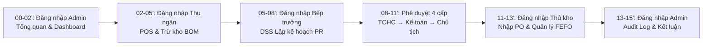

# KỊCH BẢN DEMO BÁO CÁO ĐỒ ÁN CAO HỌC MIS (TỔNG HỢP NHANH)
## HỆ THỐNG THÔNG TIN QUẢN LÝ CĂNG TIN TRƯỜNG CAO ĐẲNG CTECH
**Học phần:** Quản trị Hệ thống Thông tin Nâng cao  
**Thời lượng báo cáo:** 12 – 15 phút  
**Kiến trúc:** Phân tách Frontend (React 18 + Vite) & Backend (Python FastAPI) + CSDL Neon Cloud PostgreSQL  
**Bảo mật:** Phân quyền nghiêm ngặt (Strict RBAC) • Đăng nhập / Đăng xuất chuẩn xác thực

---

### I. CÁCH KHỞI ĐỘNG HỆ THỐNG TRƯỚC KHI BẢO VỆ
1. **Khởi động 1-Click (Khuyên dùng):** Nhấp đúp vào file [start_system.bat](file:///d:/Learning_Other/CH_TL/quan_ly_hhtt_nang_cao/CanteenManagement/start_system.bat)  
   *(Hoặc mở Terminal gõ lệnh: `npm run dev`)*.
2. Trình duyệt tự động mở tại: **`http://localhost:5173`** (Nhấn `F11` để hiển thị toàn màn hình).
3. Màn hình đầu tiên xuất hiện là **Màn hình Đăng Nhập (Login)**.

---

### II. DANH SÁCH TÀI KHOẢN ĐĂNG NHẬP 7 VAI TRÒ
*(Tại Màn hình Đăng nhập có sẵn bảng **1-Click Quick Login**, bạn chỉ cần bấm trực tiếp vào thẻ vai trò để đăng nhập ngay mà không cần gõ mật khẩu)*:

| STT | Vai trò (Role) | Họ và tên | Tên đăng nhập | Mật khẩu | Nhiệm vụ chính trong kịch bản |
|:---:|:---|:---|:---|:---|:---|
| 1 | **Thu ngân** (`CASHIER`) | Đặng Thùy Linh | `linh.pos` | `pos123` | Bán hàng POS, quét voucher Ctool, in bill, trừ kho BOM |
| 2 | **Bếp trưởng** (`CHEF`) | Nguyễn Văn Đạt | `chefnvd` | `chef123` | Bóc tách BOM, chạy mô hình DSS, lập đề xuất PR |
| 3 | **Trưởng phòng TCHC** (`TCHC`) | Trần Thị Mai | `mai.tchc` | `tchc123` | Thẩm định nhu cầu & **Phê duyệt Cấp 2** |
| 4 | **Kế toán trưởng** (`ACCOUNTANT`) | Lê Hoàng Long | `long.kt` | `kt123` | Thẩm định đơn giá NCC, ngân sách & **Phê duyệt Cấp 3** |
| 5 | **Chủ tịch HĐT** (`CHAIRMAN`) | TS. Phạm Minh Tuấn | `tuan.chutich` | `ct123` | Executive Dashboard & **Ký duyệt chi Cấp 4 (Ban hành PO)** |
| 6 | **Thủ kho** (`STOREKEEPER`) | Bùi Đức Thắng | `thang.kho` | `kho123` | Tiếp nhận hàng theo PO, nhập Lot/HSD, kiểm soát FEFO |
| 7 | **Quản trị viên** (`ADMIN`) | Ban Quản trị HTTT | `admin` | `admin123` | Giám sát toàn hệ thống, minh chứng chuỗi vết Audit Logs |

---

### III. TIẾN TRÌNH THUYẾT TRÌNH BẢO VỆ CHI TIẾT (12 – 15 PHÚT)

#### 1. Phút 00:00 – 02:00: Mở đầu & Dashboard Điều hành Tổng thể
- **Thao tác:** Đăng nhập tài khoản **`admin`** / `admin123`.
- **Màn hình:** Tab **Tổng quan Hệ thống (Admin Dashboard)**.
- **Điểm nhấn thuyết trình:**
  - Nêu 5 bài toán thực tế tại Trường Cao đẳng CTECH (dữ liệu Ctool rời rạc, ký giấy tờ 4 cấp chậm trễ 48h, lãng phí thực phẩm tươi sống).
  - Giới thiệu kiến trúc phân tách 3-Tier: Frontend React + Backend Python FastAPI kết nối trực tiếp CSDL **Neon Cloud PostgreSQL**.
  - Chỉ ra các KPI thời gian thực: Doanh thu ca bán, số suất ăn CBNV đã nhận, phiếu mua hàng đang chờ duyệt, cảnh báo nguyên liệu chạm ngưỡng an toàn.
- **Kết thúc phần 1:** Bấm nút **"Đăng xuất"** góc trên bên phải để chuyển sang phần bán hàng.

---

#### 2. Phút 02:00 – 05:00: Bán Hàng Tại Quầy POS & Động Cơ Trừ Kho BOM
- **Thao tác:** Tại màn hình đăng nhập, bấm vào thẻ **Đặng Thùy Linh (Thu ngân)**.
- **Quan sát giao diện:** Nhấn mạnh với Hội đồng: Giao diện thu ngân **chỉ có duy nhất chức năng bán hàng POS và lịch sử đơn**, hoàn toàn ẩn sạch các nút phê duyệt và kho.
- **Thực hiện 2 đơn hàng mẫu:**
  - *Đơn 1 (Sinh viên):* Chọn 1 "Cơm thịt ba chỉ kho trứng (Suất 30k)" + 1 "Trà đào cam sả (22k)" $\rightarrow$ Nhấn mạnh căn tin phục vụ đủ 2 mức suất 30.000đ và 35.000đ theo khảo sát Chương 2 $\rightarrow$ Thanh toán VietQR $\rightarrow$ In hóa đơn.
  - *Đơn 2 (Cán bộ GV - Suất ăn Ctool):* Chọn 1 "Cơm sườn nướng mật ong (35k)" $\rightarrow$ Chuyển tab khách "Suất ăn CBNV Ctool".
    - **Điểm nhấn chống gian lận:** Hệ thống **không cho nhập tên tùy ý**. Thu ngân gõ tìm kiếm (debounce search) tên cán bộ (ví dụ: gõ `Hằng` hoặc mã `0520`) $\rightarrow$ Chọn đúng giảng viên từ Ctool Dropdown.
    - Hệ thống tự động kiểm tra: Nếu cán bộ đã nhận cơm trưa rồi sẽ **báo đỏ hết lượt và khóa nút thanh toán**. Nếu hợp lệ sẽ áp dụng Voucher Ctool 35.000đ, tổng thu 0đ $\rightarrow$ Bấm Hoàn tất đơn.
- **Điểm nhấn học thuật MIS (Trừ kho tự động BOM):**
  - Ngay khi bấm thanh toán, động cơ BOM Engine lập tức trừ kho tự động: **150g sườn heo**, **120g gạo ST25**, **80g rau cải** trực tiếp trên cơ sở dữ liệu Neon PostgreSQL.
- **Kết thúc phần 2:** Bấm nút **"Đăng xuất"**.

---

#### 3. Phút 05:00 – 08:00: Hệ Hỗ Trợ Ra Quyết Định (DSS) & Lập Đề Xuất PR (Biểu Mẫu BM01)
- **Thao tác:** Bấm thẻ **Nguyễn Văn Đạt (Bếp trưởng)** để đăng nhập.
- **Màn hình:** Mở tab **Hỗ trợ Ra Quyết Định (DSS)**.
- **Điểm nhấn học thuật MIS (Mô hình toán DSS):**
  - Giới thiệu công thức tối ưu hóa đặt hàng chuỗi cung ứng:  
    $$Q_{order} = \max\left(0, D_{ctool} + D_{sinh\_vien} + SS - I_{current} - Q_{incoming}\right)$$
  - Kéo thử thanh trượt **Dự báo sinh viên** lên +20% $\rightarrow$ Bảng gợi ý tính toán lại tức thì theo thời gian thực.
  - Chỉ vào các nguyên liệu báo đỏ 🔴 **Nguy cấp (CRITICAL)**: Thịt sườn heo, rau cải Ba Vì do tồn kho cạn sau ca bán vừa rồi.
- **Thao tác chốt:** Bấm nút **"1-Click Chuyển Thành Đề Xuất Mua Hàng"** $\rightarrow$ Hệ thống tự động gom các mặt hàng thiếu, tính tổng tiền dự toán, sinh phiếu đề xuất mua hàng chuẩn hóa **Biểu Mẫu BM01** gửi lên Cấp 2.
- **Kết thúc phần 3:** Bấm nút **"Đăng xuất"**.

---

#### 4. Phút 08:00 – 11:00: Trọng Tâm - Quy Trình Phê Duyệt Mua Hàng 4 Cấp (BM01)
*(Minh chứng tính tuân thủ nguyên tắc Phân tách nhiệm vụ - Separation of Duties và kiểm soát ngân sách theo Biểu Mẫu BM01)*:

1. **Cấp 2 (Thẩm định nhu cầu & định mức):**
   - Đăng nhập **Trần Thị Mai (`mai.tchc` - Trưởng phòng TCHC)**.
   - Vào tab **Phê Duyệt Nhu Cầu (Cấp 2)** $\rightarrow$ Chỉ rõ nhãn **[Biểu Mẫu BM01]**. Giao diện **CHỈ hiển thị nút "Phê duyệt Cấp 2"** và "Từ chối".
   - Bấm **Phê Duyệt Cấp 2** $\rightarrow$ Trạng thái chuyển sang `PENDING_ACCOUNTANT`. Bấm **Đăng xuất**.
2. **Cấp 3 (Thẩm định đơn giá & ngân sách):**
   - Đăng nhập **Lê Hoàng Long (`long.kt` - Kế toán trưởng)**.
   - Vào tab **Thẩm Định Giá & NS (Cấp 3)** $\rightarrow$ Chỉ rõ nhãn **[Biểu Mẫu BM01]**, kiểm tra báo giá nhà cung cấp $\rightarrow$ Bấm **Phê Duyệt Cấp 3**.
   - Trạng thái chuyển sang `PENDING_CHAIRMAN`. Bấm **Đăng xuất**.
3. **Cấp 4 (Chủ tịch HĐT ký chi & Ban hành PO):**
   - Đăng nhập **TS. Phạm Minh Tuấn (`tuan.chutich` - Chủ tịch HĐT)**.
   - Mở **Executive Dashboard** xem bức tranh dòng tiền $\rightarrow$ Vào tab **Ký Duyệt Chi (Cấp 4)** có gắn nhãn **[Biểu Mẫu BM01]**.
   - Bấm **Ký Phê Duyệt Chi Hoàn Tất (Cấp 4) - Ban Hành PO**.
   - Phiếu chuyển thành `APPROVED`, hệ thống **tự động cấp mã Đơn đặt hàng PO chính thức** và phát tín hiệu cho Thủ kho sẵn sàng nhận hàng. Bấm **Đăng xuất**.

---

#### 5. Phút 11:00 – 13:00: Quản Trị Kho FEFO & Phiếu Kiểm Kê Kho (Biểu Mẫu BM03)
- **Thao tác:** Đăng nhập **Bùi Đức Thắng (`thang.kho` - Thủ kho)**.
- **Màn hình:** Tab **Tiếp Nhận PO Đã Duyệt**.
- **Thao tác 1 (Tiếp nhận PO):**
  - Thấy đơn PO vừa được Chủ tịch HĐT ký duyệt ở bước trước xuất hiện ở trạng thái chờ nhập.
  - Bấm nút **"Tiếp Nhận & Nhập Kho"** $\rightarrow$ Nhập số lô Lot (`LOT-20261126-CP`) và Hạn sử dụng (`EXP`) $\rightarrow$ Bấm xác nhận nhập kho.
  - Chuyển sang tab **Quản Lý Lô & Hạn Dùng (FEFO)**: Chỉ các lô hàng cận date dưới 3 ngày được hệ thống đánh dấu ưu tiên xuất trước theo nguyên tắc First-Expired, First-Out.
- **Thao tác 2 (Đối soát kiểm kê BM03):**
  - Chuyển sang tab **Kiểm Kê Kho (BM03)**:
  - Chỉ cho Hội đồng thấy bảng chuẩn **Biểu Mẫu BM03** với các cột: *Mã lô (L2611-01, L2611-12...), Tồn sổ sách, Tồn thực tế, Chênh lệch, Nguyên nhân giải trình (Hao hụt tự nhiên, dập nát bảo quản)*.
  - Thể hiện tính minh bạch với đại diện chữ ký 3 bên: *Thủ kho lập biên bản - Bếp trưởng xác nhận - Kế toán trưởng thẩm định*.
  - Bấm nút **"In Phiếu BM03"** để xuất biên bản kiểm kê định kỳ.
- **Kết thúc phần 5:** Bấm nút **"Đăng xuất"**.

---

#### 6. Phút 13:00 – 15:00: Tích Hợp Ctool (Biểu Mẫu BM02), Audit Log & Kết Luận
- **Thao tác:** Đăng nhập lại **`admin`** (Quản trị viên).
- **Màn hình 1 (Giám sát Suất ăn Ctool - Biểu Mẫu BM02):**
  - Mở tab **Kế Hoạch Suất Ăn Ctool** có gắn nhãn **[Biểu Mẫu BM02]**.
  - Chỉ rõ mốc thời gian **Chốt 21h00 hằng ngày** trên Header và giao diện.
  - Danh sách cán bộ nhân viên đăng ký ăn trưa, hiển thị tiến độ đối soát ai đã nhận cơm tại quầy POS trong ngày.
- **Màn hình 2 (Nhật Ký Kiểm Toán - Audit Logs):**
  - Chỉ cho Hội đồng thấy chuỗi vết kiểm toán được lưu bất biến trong Neon PostgreSQL:
    - `02:15`: Thu ngân Đặng Thùy Linh bán đơn POS (ORD-...) $\rightarrow$ trừ kho BOM.
    - `05:30`: Bếp trưởng Nguyễn Văn Đạt chạy DSS $\rightarrow$ tạo phiếu PR (BM01).
    - `08:45`: TP. TCHC Trần Thị Mai phê duyệt Cấp 2.
    - `09:30`: Kế toán trưởng Lê Hoàng Long duyệt Cấp 3.
    - `10:15`: Chủ tịch HĐT TS. Phạm Minh Tuấn ký Cấp 4 ban hành PO.
    - `11:40`: Thủ kho Bùi Đức Thắng nhập lô hàng FEFO & lập biên bản kiểm kê BM03.
- **Lời kết luận:** Nhấn mạnh 4 giá trị đạt được: (1) Rút ngắn thời gian duyệt mua hàng từ 48h xuống vài phút; (2) Tối ưu hóa tồn kho bằng DSS; (3) Triệt tiêu rủi ro an toàn thực phẩm bằng FEFO; (4) Chuẩn hóa 100% các biểu mẫu nghiệp vụ BM01, BM02, BM03 theo yêu cầu quản lý thực tế của Trường Cao đẳng CTECH.

---

> 📖 **Xem kịch bản chi tiết từng câu thoại thuyết trình và bộ 10 câu hỏi phản biện của Hội đồng tại:**  
> 👉 [**docs/06_Kich_Ban_Demo_Thuyet_Trinh.md**](file:///d:/Learning_Other/CH_TL/quan_ly_hhtt_nang_cao/CanteenManagement/docs/06_Kich_Ban_Demo_Thuyet_Trinh.md)
