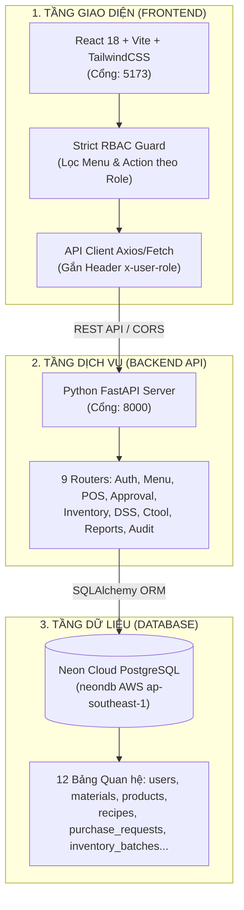

# HỆ THỐNG THÔNG TIN QUẢN LÝ CĂNG TIN TRƯỜNG CAO ĐẲNG CTECH
## Project Demo Môn học: Quản trị Hệ thống Thông tin Nâng cao (Cao học MIS)

> **Học phần:** Quản trị Hệ thống Thông tin Nâng cao  
> **Đề tài:** XÂY DỰNG HỆ THỐNG THÔNG TIN QUẢN LÝ CĂNG TIN TRƯỜNG CAO ĐẲNG CTECH  
> **Kiến trúc:** Phân tách Frontend (React 18 + Vite) & Backend (Python FastAPI) + CSDL Neon Cloud PostgreSQL  
> **Cơ chế:** Phân quyền nghiêm ngặt theo Role (Strict RBAC) - Giao diện cá nhân hóa theo Use Case, không để lộ quyền chéo.

---

## 1. TỔNG QUAN HỆ THỐNG

Dự án giải quyết 5 bài toán cốt lõi trong thực trạng quản lý vận hành căng tin tại **Trường Cao đẳng CTECH**:
1. **Rời rạc dữ liệu:** Dữ liệu suất ăn CBNV từ phần mềm Ctool, máy chấm công vân tay ZKTeco và quầy bán hàng cho sinh viên trước đây không liên thông.
2. **Quy trình mua sắm thủ công, ách tắc:** Phiếu đề xuất mua hàng bằng giấy phải trình ký qua 4 cấp (Bếp trưởng $\rightarrow$ Phòng TCHC $\rightarrow$ Phòng Kế toán $\rightarrow$ Hội đồng trường) mất 1–2 ngày.
3. **Lãng phí nguyên vật liệu:** Thiếu công cụ dự báo nhu cầu (DSS), dẫn đến thừa hoặc thiếu thực phẩm tươi sống; không quản lý được lô và hạn sử dụng (FEFO).
4. **Thất thoát tài chính:** Không thể đối soát tự động giữa định mức chế biến (BOM) và doanh thu thực tế thu được tại quầy POS.
5. **Thiếu dấu vết kiểm toán:** Khó khăn khi quy trách nhiệm nếu xảy ra sự cố an toàn vệ sinh thực phẩm hoặc sai lệch số liệu kiểm kê.

---

## 2. KIẾN TRÚC HỆ THỐNG PHÂN TÁCH (DECOUPLED ARCHITECTURE)

Hệ thống được thiết kế theo mô hình **3-Tier Phân tách Độc lập**:



### Công nghệ sử dụng:
- **Frontend:** React 18, Vite 5, TailwindCSS 3, Lucide React Icons. Chạy tại `http://localhost:5173`.
- **Backend:** Python 3.10+, FastAPI, Uvicorn, SQLAlchemy ORM, Pydantic v2. Chạy tại `http://127.0.0.1:8000`.
- **Database:** Neon Cloud Serverless PostgreSQL 18 (AWS ap-southeast-1 pooler, SSL require).
- **Tài liệu API tương tác:** Swagger UI tự động tại `http://127.0.0.1:8000/docs`.

---

## 3. MA TRẬN PHÂN QUYỀN NGHIÊM NGẶT (STRICT RBAC)

Tuân thủ nguyên tắc: **Role nào không có quyền thực hiện hành động X thì giao diện tuyệt đối không hiển thị nút hoặc chức năng của hành động X**.

| Vai trò (Role) | Người dùng đại diện | Chức năng được phép hiển thị trên UI | Hành động bị ẩn / Chặn quyền |
|:---|:---|:---|:---|
| **Thu ngân (`CASHIER`)** | Đặng Thùy Linh | • Quầy Bán Hàng POS (bán hàng, quét voucher, in bill)<br/>• Lịch sử đơn bán trong ca | Ẩn toàn bộ Menu Quản lý Kho, DSS, Duyệt mua hàng, Báo cáo tài chính. |
| **Bếp trưởng (`CHEF`)** | Nguyễn Văn Đạt | • Thực đơn & Bảng định mức BOM<br/>• Hệ thống Hỗ trợ ra Quyết định (DSS)<br/>• Lập Đề xuất Mua hàng (PR Cấp 1)<br/>• Kế hoạch Suất ăn Ctool cần nấu | **Tuyệt đối không hiển thị các nút Duyệt Cấp 2, 3, 4**. Chỉ có nút "Lập đề xuất". |
| **Trưởng phòng TCHC (`TCHC`)** | Trần Thị Mai | • **Chỉ hiển thị nút "Phê duyệt Cấp 2"** cho các phiếu `PENDING_TCHC`<br/>• Giám sát suất ăn Ctool & đối soát quẹt vân tay<br/>• Báo cáo tổng hợp vận hành | Không có quyền duyệt giá (Cấp 3) hoặc duyệt chi ngân sách (Cấp 4). |
| **Kế toán trưởng (`ACCOUNTANT`)** | Lê Hoàng Long | • **Chỉ hiển thị nút "Phê duyệt Cấp 3"** (thẩm định đơn giá NCC, ngân sách)<br/>• Quản lý danh bạ Nhà cung cấp & Báo giá<br/>• Báo cáo Tài chính & Dòng tiền | Không có quyền ký lệnh chi chính thức PO (Cấp 4). |
| **Chủ tịch Hội đồng (`CHAIRMAN`)** | TS. Phạm Minh Tuấn | • Executive Dashboard (Dòng tiền, chi phí, doanh thu)<br/>• **Chỉ hiển thị nút "Ký Duyệt Chi Cấp 4 (Ban Hành PO)"** | Không phải thao tác các khâu kiểm đếm kho chi tiết. |
| **Thủ kho (`STOREKEEPER`)** | Bùi Đức Thắng | • Tiếp nhận hàng theo PO đã duyệt (Nhập Lô & HSD)<br/>• Quản lý tồn kho nguyên vật liệu & Nút "Điều chỉnh kiểm kê"<br/>• Quản lý hạn sử dụng theo lô (FEFO) | Không có quyền bán hàng POS, không duyệt chi ngân sách. |
| **Quản trị viên (`ADMIN`)** | Ban Quản trị HTTT | • Dashboard toàn diện hệ thống<br/>• Quản trị người dùng & phân quyền RBAC<br/>• Nhật ký kiểm toán an toàn thông tin (Audit Logs) | Truy cập toàn quyền hỗ trợ kỹ thuật và giám sát. |

### Danh sách tài khoản đăng nhập mẫu (Demo Credentials)
Hệ thống tích hợp màn hình đăng nhập bảo mật với bảng chọn nhanh (1-Click Quick Login):

| Vai trò (Role) | Họ và tên | Tên đăng nhập (Username) | Mật khẩu (Password) |
|:---|:---|:---|:---|
| **Thu ngân** (`CASHIER`) | Đặng Thùy Linh | `linh.pos` | `pos123` |
| **Bếp trưởng** (`CHEF`) | Nguyễn Văn Đạt | `chefnvd` | `chef123` |
| **Trưởng phòng TCHC** (`TCHC`) | Trần Thị Mai | `mai.tchc` | `tchc123` |
| **Kế toán trưởng** (`ACCOUNTANT`) | Lê Hoàng Long | `long.kt` | `kt123` |
| **Chủ tịch HĐT** (`CHAIRMAN`) | TS. Phạm Minh Tuấn | `tuan.chutich` | `ct123` |
| **Thủ kho** (`STOREKEEPER`) | Bùi Đức Thắng | `thang.kho` | `kho123` |
| **Quản trị viên** (`ADMIN`) | Ban Quản trị HTTT | `admin` | `admin123` |

---

## 4. CẤU TRÚC THƯ MỤC DỰ ÁN

```text
CanteenManagement/
├── backend/                         # Backend Python FastAPI
│   ├── .env                         # Chuỗi kết nối Neon PostgreSQL (Bảo mật riêng cho BE)
│   ├── app/
│   │   ├── __init__.py
│   │   ├── database.py              # Kết nối PostgreSQL qua SQLAlchemy
│   │   ├── models.py                # 12 ORM Models (Users, Materials, PR, BOM...)
│   │   ├── schemas.py               # Pydantic Schemas xác thực dữ liệu
│   │   ├── seed.py                  # Script nạp dữ liệu mẫu CTECH vào PostgreSQL
│   │   ├── main.py                  # Khởi tạo FastAPI App, CORS, gộp Routers
│   │   └── routers/                 # 9 API Routers độc lập
│   │       ├── auth.py
│   │       ├── menu.py
│   │       ├── pos.py
│   │       ├── approval.py
│   │       ├── inventory.py
│   │       ├── dss.py
│   │       ├── ctool.py
│   │       ├── reports.py
│   │       └── audit.py
│   └── run_backend.py               # Runner khởi động Uvicorn cổng 8000
│
├── frontend/                        # Frontend React 18 + Vite
│   ├── src/
│   │   ├── api/
│   │   │   └── apiClient.js         # API Client kết nối Backend FastAPI
│   │   ├── components/
│   │   │   ├── Header.jsx           # Switcher chuyển đổi vai trò & trạng thái kết nối
│   │   │   └── Sidebar.jsx          # Thanh điều hướng lọc nghiêm ngặt theo RBAC
│   │   ├── context/
│   │   │   └── AppContext.jsx       # State management đồng bộ PostgreSQL thời gian thực
│   │   ├── data/
│   │   │   └── roles.js             # Định nghĩa ma trận quyền và người dùng CTECH
│   │   ├── pages/                   # 19 View chuyên biệt theo từng Role
│   │   │   ├── CashierPOSView.jsx
│   │   │   ├── CashierHistoryView.jsx
│   │   │   ├── ChefMenuBOMView.jsx
│   │   │   ├── ChefDSSView.jsx
│   │   │   ├── ChefPRView.jsx
│   │   │   ├── ApprovalLevel2View.jsx
│   │   │   ├── ApprovalLevel3View.jsx
│   │   │   ├── ApprovalLevel4View.jsx
│   │   │   ├── StorekeeperReceiveView.jsx
│   │   │   ├── StorekeeperStockView.jsx
│   │   │   ├── StorekeeperFEFOView.jsx
│   │   │   ├── CtoolMonitorView.jsx
│   │   │   ├── SuppliersView.jsx
│   │   │   ├── FinancialReportsView.jsx
│   │   │   ├── GeneralReportsView.jsx
│   │   │   ├── ExecutiveDashboardView.jsx
│   │   │   ├── AdminDashboardView.jsx
│   │   │   ├── AdminUsersView.jsx
│   │   │   └── AuditLogsView.jsx
│   │   ├── App.jsx
│   │   └── main.jsx
│   ├── package.json
│   └── vite.config.js               # Proxy /api sang http://127.0.0.1:8000
│
├── docs/                            # BỘ TÀI LIỆU HỌC THUẬT CAO HỌC (Markdown)
│   ├── 01_Tong_Quan_Va_Khao_Sat_Hien_Trang.md
│   ├── 02_Phan_Tich_Yeu_Cau_Va_Mo_Hinh_Hoa.md
│   ├── 03_Thiet_Ke_Kien_Truc_Va_CSDL.md
│   ├── 04_Thiet_Ke_Chi_Tiet_Phe_Duyet_4_Cap_Va_DSS.md
│   ├── 05_Ke_Hoach_Phat_Trien_Kiem_Thu_Va_Trien_Khai.md
│   └── 06_Kich_Ban_Demo_Thuyet_Trinh.md
│
├── KICH_BAN_DEMO.md                 # Kịch bản demo thuyết trình rút gọn 12-15 phút
├── TASK_CHECKLIST.md                # Bảng theo dõi tiến độ công việc
├── start_system.bat                 # Script 1-Click khởi động song song cả FE và BE
└── package.json                     # Root scripts (npm run dev)
```

---

## 5. HƯỚNG DẪN CÀI ĐẶT & KHỞI ĐỘNG HỆ THỐNG

### Cách 1: Khởi động 1-Click (Khuyên dùng khi bảo vệ / demo)
Nhấp đúp chuột vào file:
```cmd
start_system.bat
```
Script sẽ tự động:
1. Mở cửa sổ 1: Chạy Backend Python FastAPI trên cổng `8000`.
2. Mở cửa sổ 2: Chạy Frontend React Vite trên cổng `5173`.
3. Tự động mở trình duyệt web tại địa chỉ `http://localhost:5173`.

---

### Cách 2: Khởi động qua dòng lệnh (Terminal)

#### Khởi động song song cả 2 thành phần (1 lệnh duy nhất):
```bash
npm run dev
```
*(Lệnh này sử dụng concurrently để chạy song song Backend FastAPI và Frontend Vite trong cùng một terminal).*

#### Hoặc khởi động từng thành phần độc lập:
- **Backend:**
  ```bash
  python backend/run_backend.py
  ```
  *(Server lắng nghe tại `http://127.0.0.1:8000`, Swagger UI tại `http://127.0.0.1:8000/docs`).*

- **Frontend:**
  ```bash
  cd frontend
  npm run dev
  ```
  *(Truy cập tại `http://localhost:5173`).*

- **Nạp lại dữ liệu mẫu PostgreSQL (nếu cần reset):**
  ```bash
  python -m backend.app.seed
  ```

---

## 6. KỊCH BẢN THUYẾT TRÌNH BẢO VỆ (12–15 PHÚT)

Thực hiện theo các bước chuẩn trong tài liệu [KICH_BAN_DEMO.md](file:///d:/Learning_Other/CH_TL/quan_ly_hhtt_nang_cao/CanteenManagement/KICH_BAN_DEMO.md):

1. **Phút 00–03:** Mở vai trò **Thu ngân (`CASHIER`)** $\rightarrow$ Thực hiện bán 1 đĩa "Cơm sườn nướng mật ong" bằng tiền mặt hoặc quét voucher Ctool $\rightarrow$ Xem hóa đơn $\rightarrow$ Chứng minh tồn kho thịt sườn giảm tự động 150g theo BOM.
2. **Phút 03–06:** Chuyển sang vai trò **Bếp trưởng (`CHEF`)** $\rightarrow$ Vào tab **Hỗ trợ Ra Quyết Định (DSS)** $\rightarrow$ Kéo thanh trượt tham số tăng trưởng sinh viên lên 1.2 $\rightarrow$ Bấm nút "1-Click Sinh Đề Xuất Mua Hàng (PR)" $\rightarrow$ Hệ thống tự động tạo mã phiếu PR gửi lên Cấp 2.
3. **Phút 06–09:** Trực quan hóa **Quy trình Phê duyệt 4 Cấp**:
   - Chuyển vai trò **Trưởng phòng TCHC (`TCHC`)** $\rightarrow$ Bấm "Phê duyệt Cấp 2 (Thẩm định nhu cầu)".
   - Chuyển vai trò **Kế toán trưởng (`ACCOUNTANT`)** $\rightarrow$ Xem báo giá nhà cung cấp $\rightarrow$ Bấm "Phê duyệt Cấp 3 (Thẩm định giá & ngân sách)".
   - Chuyển vai trò **Chủ tịch HĐT (`CHAIRMAN`)** $\rightarrow$ Xem Dashboard dòng tiền $\rightarrow$ Bấm "Ký Duyệt Chi Cấp 4 $\rightarrow$ Ban hành Đơn đặt hàng (PO) chính thức".
4. **Phút 09–12:** Chuyển sang vai trò **Thủ kho (`STOREKEEPER`)** $\rightarrow$ Mở tab "Tiếp nhận PO đã duyệt" $\rightarrow$ Nhập số lô Lot và Hạn sử dụng (EXP) $\rightarrow$ Hoàn tất nhập kho $\rightarrow$ Xem danh mục quản lý theo hạn sử dụng **FEFO**.
5. **Phút 12–15:** Chuyển sang vai trò **Quản trị viên (`ADMIN`)** $\rightarrow$ Trình chiếu **Nhật ký kiểm toán (Audit Logs)** minh bạch toàn bộ các thao tác đã diễn ra trong phiên làm việc.

---

## 7. BỘ TÀI LIỆU CHI TIẾT ĐÍNH KÈM

- 📘 [01. Tổng quan & Khảo sát Hiện trạng](file:///d:/Learning_Other/CH_TL/quan_ly_hhtt_nang_cao/CanteenManagement/docs/01_Tong_Quan_Va_Khao_Sat_Hien_Trang.md)
- 📘 [02. Phân tích Yêu cầu & Mô hình hóa Use Case](file:///d:/Learning_Other/CH_TL/quan_ly_hhtt_nang_cao/CanteenManagement/docs/02_Phan_Tich_Yeu_Cau_Va_Mo_Hinh_Hoa.md)
- 📘 [03. Thiết kế Kiến trúc & Cơ sở Dữ liệu PostgreSQL](file:///d:/Learning_Other/CH_TL/quan_ly_hhtt_nang_cao/CanteenManagement/docs/03_Thiet_Ke_Kien_Truc_Va_CSDL.md)
- 📘 [04. Thiết kế Quy trình Phê duyệt 4 Cấp & Thuật toán DSS](file:///d:/Learning_Other/CH_TL/quan_ly_hhtt_nang_cao/CanteenManagement/docs/04_Thiet_Ke_Chi_Tiet_Phe_Duyet_4_Cap_Va_DSS.md)
- 📘 [05. Kế hoạch Phát triển, Kiểm thử & Triển khai](file:///d:/Learning_Other/CH_TL/quan_ly_hhtt_nang_cao/CanteenManagement/docs/05_Ke_Hoach_Phat_Trien_Kiem_Thu_Va_Trien_Khai.md)
- 📘 [06. Kịch bản Thuyết trình Bảo vệ & Câu hỏi Phản biện](file:///d:/Learning_Other/CH_TL/quan_ly_hhtt_nang_cao/CanteenManagement/docs/06_Kich_Ban_Demo_Thuyet_Trinh.md)
