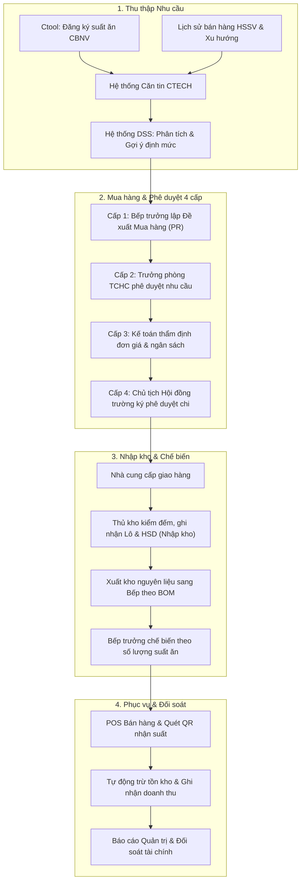
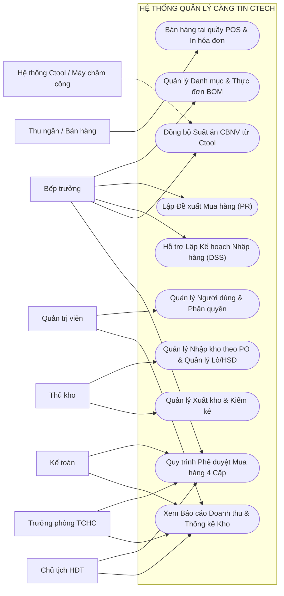
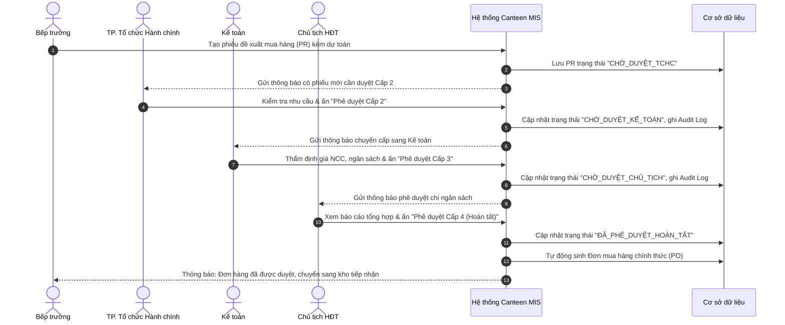

# CHƯƠNG 2: PHÂN TÍCH NGHIỆP VỤ VÀ MÔ HÌNH HÓA HỆ THỐNG QUẢN LÝ CĂNG TIN CTECH

---

### 2.1. Khảo sát và phân tích nghiệp vụ quản lý căng tin
Hệ thống quản lý căng tin trường Cao đẳng CTECH bao gồm các nghiệp vụ đan xen chặt chẽ:
1. **Nghiệp vụ tài khoản & phân quyền (RBAC):** Quản lý người dùng theo vai trò, gán quyền chi tiết trên từng chức năng và dữ liệu.
2. **Nghiệp vụ danh mục & định mức chế biến (BOM):** Mỗi món ăn (ví dụ: *Cơm sườn nướng mật ong*) được cấu thành từ các định mức nguyên liệu (*150g sườn heo, 100g gạo tấm, 20ml mật ong, gia vị...*).
3. **Nghiệp vụ tích hợp Ctool & Suất ăn CBNV:** Mỗi ngày lúc 09h30, hệ thống tự động đồng bộ danh sách CBNV đã đăng ký ăn trưa và có check-in máy chấm công, sinh ra tổng số suất ăn CBNV cần chuẩn bị.
4. **Nghiệp vụ bán hàng & POS:** Thu ngân phục vụ HSSV và CBNV, quét mã hoặc chọn món trên màn hình cảm ứng, thanh toán bằng tiền mặt hoặc QR Code, in hóa đơn hoặc trừ ví suất ăn.
5. **Nghiệp vụ đề xuất & phê duyệt mua hàng 4 cấp:** Khi tồn kho xuống dưới mức an toàn hoặc chuẩn bị cho thực đơn tuần mới, hệ thống kích hoạt luồng phê duyệt 4 cấp: Bếp trưởng $\rightarrow$ Trưởng phòng TCHC $\rightarrow$ Kế toán $\rightarrow$ Chủ tịch Hội đồng trường.
6. **Nghiệp vụ quản lý kho (WMS):** Nhập kho theo đơn mua đã duyệt, xuất kho phục vụ bếp chế biến, theo dõi số lô và hạn sử dụng (FEFO), kiểm kê đối soát định kỳ.
7. **Nghiệp vụ hỗ trợ ra quyết định (DSS):** Thuật toán tự động phân tích dữ liệu lịch sử và số suất ăn dự kiến để tính toán lượng thực phẩm cần nhập cho ngày mai.

---

### 2.2. Phân tích các quy trình nghiệp vụ đề xuất

---

### 2.3. Xác định tác nhân sử dụng hệ thống (Actors)

| STT | Tác nhân (Actor) | Trách nhiệm chính | Quyền hạn trong hệ thống |
|:---:|:---|:---|:---|
| 1 | **Quản trị viên (Admin)** | Quản trị người dùng, cấu hình tham số hệ thống, giám sát Audit Log. | Toàn quyền quản trị hệ thống |
| 2 | **Bếp trưởng (Chef)** | Quản lý thực đơn, định mức BOM, xem số suất ăn Ctool, lập phiếu Đề xuất mua hàng (PR), yêu cầu xuất kho nguyên liệu. | Quản lý thực đơn, tạo PR, xem DSS |
| 3 | **Trưởng phòng TCHC** | Giám sát vận hành căng tin, phê duyệt đề xuất mua hàng Cấp 2 (kiểm soát sự cần thiết và chất lượng). | Duyệt Cấp 2, xem báo cáo tổng hợp |
| 4 | **Kế toán (Accountant)** | Kiểm soát đơn giá nhà cung cấp, công nợ, ngân sách, phê duyệt mua hàng Cấp 3, đối soát doanh thu POS. | Duyệt Cấp 3, quản lý tài chính & NCC |
| 5 | **Chủ tịch HĐT (Chairman)** | Lãnh đạo cấp cao, phê duyệt chi ngân sách cuối cùng (Cấp 4), xem Dashboard quản trị điều hành trường. | Duyệt Cấp 4, Dashboard cấp cao |
| 6 | **Thủ kho (Storekeeper)** | Thực hiện nhập kho thực tế từ đơn mua đã duyệt, kiểm kê tồn kho, xuất kho theo phiếu, kiểm soát hạn sử dụng. | Quản lý kho, nhập/xuất, kiểm kê |
| 7 | **Nhân viên Bán hàng/Thu ngân** | Trực tiếp thao tác trên màn hình POS bán đồ ăn, nước uống, nhận diện CBNV qua thẻ/mã để cấp suất ăn. | Phân hệ POS, thu ngân, in bill |
| 8 | **Hệ thống Ctool / Máy chấm công** | Tác nhân bên ngoài (External System): cung cấp dữ liệu điểm danh và suất ăn đăng ký của giảng viên, cán bộ. | API tích hợp dữ liệu tự động |

---

### 2.4. Phân tích yêu cầu chức năng (Functional Requirements)

1. **Phân hệ Quản trị & Phân quyền:**
   - Quản lý danh sách tài khoản, mật khẩu, trạng thái hoạt động.
   - Phân quyền theo vai trò (RBAC) chặt chẽ giữa 7 vai trò người dùng.
   - Ghi nhận Audit Log mọi hành động quan trọng (tạo đơn, sửa đơn giá, duyệt, hủy).

2. **Phân hệ Danh mục & Định mức (BOM):**
   - Phân loại danh mục: Món ăn chế biến, Đồ uống đóng chai, Nguyên vật liệu tươi sống, Gia vị/Hàng khô.
   - Thiết lập bảng định mức nguyên vật liệu cho từng món ăn (Ví dụ: 1 suất Phở bò = 150g bánh phở, 80g thịt bò tái, 20g hành lá, 400ml nước dùng).

3. **Phân hệ Tích hợp Dữ liệu Ctool:**
   - Nhận diện danh sách CBNV đăng ký ăn trưa hôm nay từ Ctool.
   - Đối chiếu với dữ liệu quẹt vân tay chấm công buổi sáng.
   - Thống kê tự động: Số suất ăn tiêu chuẩn, số suất ăn chay/đặc biệt, thời gian chốt lúc 09h30.

4. **Phân hệ Bán hàng & POS:**
   - Giao diện cảm ứng tối ưu cho thu ngân thao tác nhanh trong giờ cao điểm.
   - Tìm kiếm món ăn theo tên, mã vạch hoặc danh mục trực quan.
   - Hỗ trợ thanh toán: Tiền mặt, Quét mã VietQR chuyển khoản ngân hàng, Quẹt thẻ/chọn suất ăn CBNV Ctool.
   - In hóa đơn và cập nhật doanh thu thời gian thực.

5. **Phân hệ Phê duyệt Mua hàng 4 Cấp (Core Workflow):**
   - Lập phiếu yêu cầu mua hàng (Purchase Requisition - PR) tự động từ DSS hoặc thủ công.
   - Luồng duyệt tuần tự 4 cấp: Bếp trưởng $\rightarrow$ Trưởng phòng TCHC $\rightarrow$ Kế toán $\rightarrow$ Chủ tịch HĐT.
   - Giao diện trực quan thể hiện Timeline trạng thái từng cấp (Đang chờ, Đã duyệt, Đã từ chối kèm lý do).
   - Khi Chủ tịch HĐT duyệt, phiếu tự động chuyển thành Đơn mua hàng chính thức (Purchase Order - PO) gửi sang kho để chờ tiếp nhận.

6. **Phân hệ Quản lý Kho & Tồn kho:**
   - Nhập kho: Căn cứ theo PO đã được duyệt 4 cấp, ghi nhận số lượng thực nhận, nhà cung cấp, số lô (Batch No) và ngày hết hạn (Expiry Date).
   - Xuất kho: Xuất theo yêu cầu bếp hoặc xuất tự động theo số lượng suất ăn bán ra trong ngày.
   - Cảnh báo tồn kho an toàn: Thông báo các mặt hàng sắp hết hoặc các lô hàng sắp cận date (trong vòng 3-7 ngày).
   - Kiểm kê kho: Lập phiếu kiểm kê, ghi nhận số chênh lệch thừa/thiếu và cập nhật tồn kho sau phê duyệt điều chỉnh.

7. **Phân hệ Hỗ trợ Lập Kế hoạch Nhập hàng (DSS):**
   - Thu thập 3 nguồn dữ liệu: Tồn kho thực tế hiện tại, Số suất ăn CBNV Ctool ngày mai, Mức tiêu thụ dự báo cho HSSV (dựa trên trung bình động 7 ngày gần nhất).
   - Áp dụng công thức tính toán lượng nguyên liệu cần nhập:
     $$Q_{order} = \max\left(0, D_{forecast} + SS - I_{current} - Q_{incoming}\right)$$
   - Tự động sinh danh mục hàng cần mua và cho phép chuyển thành phiếu Đề xuất mua hàng với 1 click.

8. **Phân hệ Báo cáo & Thống kê Quản trị:**
   - Báo cáo doanh thu bán hàng theo ngày/tuần/tháng, theo ca bán.
   - Báo cáo tỷ trọng tiêu thụ giữa HSSV và Suất ăn CBNV.
   - Báo cáo Nhập - Xuất - Tồn (N-X-T) từng nguyên vật liệu.
   - Báo cáo chi phí mua hàng và tình hình giải ngân theo ngân sách được duyệt.

---

### 2.5. Phân tích yêu cầu phi chức năng (Non-Functional Requirements)

1. **Hiệu năng và Tốc độ (Performance):**
   - Thời gian xử lý 1 đơn bán hàng trên POS dưới 1.5 giây.
   - Thời gian tải trang Dashboard và tính toán DSS dưới 2 giây.
   - Đảm bảo hệ thống hoạt động trơn tru trong khung giờ cao điểm 11h30 - 12h30 khi có cùng lúc nhiều giao dịch.
2. **Bảo mật và Phân quyền (Security & Access Control):**
   - Áp dụng RBAC nghiêm ngặt: Nhân viên bán hàng không thể xem báo cáo tài chính cấp cao; chỉ Chủ tịch HĐT mới có quyền duyệt chi cuối cùng.
   - Cơ chế mã hóa dữ liệu nhạy cảm và lưu vết Audit Log không thể chỉnh sửa.
3. **Tính chính xác và Toàn vẹn dữ liệu (Data Integrity):**
   - Đảm bảo tính nhất quán giữa số lượng trừ kho và số lượng món bán ra theo định mức BOM.
   - Ràng buộc khóa ngoại và toàn vẹn giao dịch (ACID).
4. **Khả năng tương thích và Giao diện người dùng (Usability & Responsiveness):**
   - Giao diện thân thiện, hiện đại, hỗ trợ cả màn hình máy tính bàn, màn hình cảm ứng POS và thiết bị di động (để lãnh đạo duyệt đơn mọi lúc mọi nơi).

---

### 2.6. Mô hình hóa hệ thống (UML Diagrams)

#### 2.6.1. Biểu đồ Use Case tổng quát

#### 2.6.2. Biểu đồ Sequence Quy trình Phê duyệt Mua hàng 4 Cấp

