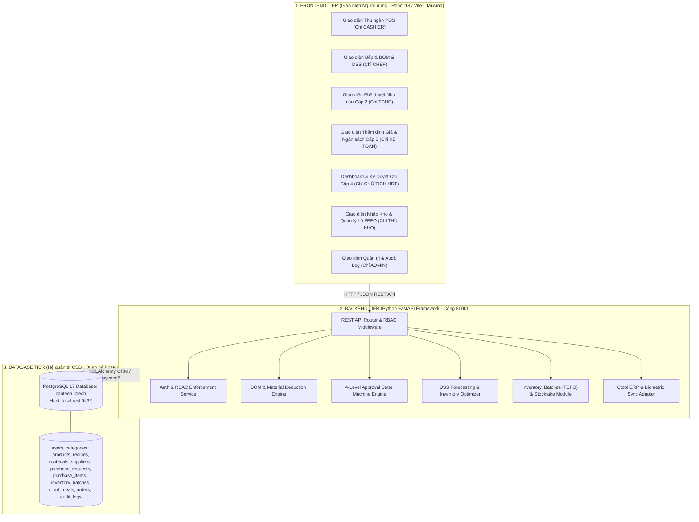

# CHƯƠNG 3: THIẾT KẾ KIẾN TRÚC PHÂN TÁCH FE - BE VÀ CƠ SỞ DỮ LIỆU POSTGRESQL

---

### 3.1. Thiết kế kiến trúc tổng thể Phân tách Độc lập (FE & BE)

Hệ thống Quản lý Căng tin Trường Cao đẳng CTECH được thiết kế theo mô hình kiến trúc phân tán **Client - Server (Decoupled 3-Tier Architecture)** chuẩn mực với sự phân tách hoàn toàn giữa **Frontend (FE)** và **Backend (BE)** giao tiếp thông qua giao thức **RESTful API**:



---

### 3.2. Ma trận Phân quyền Use Case & Thiết kế Giao diện Cá nhân hóa Nghiêm ngặt

> [!IMPORTANT]
> **Nguyên tắc thiết kế giao diện:** 
> Hệ thống áp dụng nguyên tắc **Zero-Leakage UI**: Mỗi vai trò chỉ nhìn thấy các Menu và các Action Button thuộc phạm vi Use Case của mình. Tuyệt đối không để trường hợp vai trò không có quyền X nhưng giao diện lại hiển thị hành động X.

| Vai trò (Actor) | Phạm vi Use Case được phép | Menu hiển thị trên Sidebar | Các Action Buttons được phép thao tác trên UI | Các hành động BỊ CẤM HOÀN TOÀN (Ẩn triệt để khỏi UI) |
|:---|:---|:---|:---|:---|
| **CASHIER**<br>*(Thu ngân)* | UC4: Bán hàng POS, in bill.<br>UC4.1: Nhận diện suất CBNV Ctool.<br>UC10.1: Xem ca bán cá nhân. | • Quầy Bán Hàng POS<br>• Lịch Sử Đơn Ca Bán | • Thêm món giỏ hàng<br>• Thanh toán Tiền mặt / VietQR / Ctool<br>• In hóa đơn | ❌ Không thấy menu Phê duyệt<br>❌ Không thấy kho WMS<br>❌ Không thấy công thức BOM<br>❌ Không thấy DSS hay Báo cáo tài chính |
| **CHEF**<br>*(Bếp trưởng)* | UC2: Quản lý thực đơn & BOM.<br>UC3: Xem số suất Ctool cần nấu.<br>UC5: Lập phiếu Đề xuất mua (PR Cấp 1).<br>UC9: Chạy DSS tính lượng nhập. | • Thực Đơn & Định Mức BOM<br>• Kế Hoạch Suất Ăn Ctool<br>• Hỗ Trợ Ra Quyết Định DSS<br>• Đề Xuất Mua Hàng (PR) | • Sửa/thêm định mức BOM<br>• Điều chỉnh slider DSS<br>• 1-Click tạo PR từ DSS<br>• Lập phiếu đề xuất mới | ❌ **Tuyệt đối KHÔNG có nút Duyệt Cấp 2, 3, 4**<br>❌ Không có màn hình POS<br>❌ Không có nút Tiếp nhận nhập kho |
| **TCHC**<br>*(TP. Tổ chức HC)* | UC6.2: Phê duyệt Mua hàng CẤP 2 (Nhu cầu).<br>UC3: Giám sát suất ăn CBNV.<br>UC10: Báo cáo vận hành chung. | • Phê Duyệt Cấp 2 (Nhu Cầu)<br>• Giám Sát Suất Ăn Ctool<br>• Báo Cáo Tổng Hợp Vận Hành | • Nút **"Phê duyệt Cấp 2"** (chỉ cho phiếu PENDING_TCHC)<br>• Nút **"Từ chối"** kèm lý do | ❌ Không có nút Lập phiếu PR mới<br>❌ Không có nút Duyệt Cấp 3 hoặc Cấp 4<br>❌ Không có POS, Kho, BOM |
| **ACCOUNTANT**<br>*(Kế toán trưởng)* | UC6.3: Phê duyệt Mua hàng CẤP 3 (Đơn giá & Ngân sách).<br>UC7.1: Quản lý NCC & Giá hợp đồng.<br>UC10: Báo cáo Tài chính, Đối soát. | • Thẩm Định Giá & Ngân Sách (Cấp 3)<br>• Quản Lý Nhà Cung Cấp<br>• Báo Cáo Tài Chính & Đối Soát | • Nút **"Phê duyệt Cấp 3"** (chỉ cho phiếu PENDING_ACCOUNTANT)<br>• Nút **"Yêu cầu đàm phán lại giá"** | ❌ Không có nút Duyệt Cấp 2 hoặc Cấp 4<br>❌ Không có nút Bán hàng POS<br>❌ Không có nút Nhập kho |
| **CHAIRMAN**<br>*(Chủ tịch HĐT)* | UC6.4: Phê duyệt Chi Tối Cao (CẤP 4) $\rightarrow$ Sinh PO.<br>UC10: Executive Dashboard. | • Dashboard Lãnh Đạo Cấp Cao<br>• Ký Duyệt Chi Mua Hàng (Cấp 4) | • Nút **"Ký Phê Duyệt Chi Hoàn Tất (Cấp 4)"** (Sinh PO)<br>• Nút **"Bác bỏ đề xuất chi"** | ❌ Không có bất kỳ nút thao tác quầy, bếp hay kho |
| **STOREKEEPER**<br>*(Thủ kho)* | UC7: Quản lý tồn kho thực phẩm.<br>UC7.2: Tiếp nhận PO đã duyệt $\rightarrow$ Nhập Lô & HSD (FEFO).<br>UC8: Kiểm kê định kỳ, điều chỉnh tồn. | • Tồn Kho Nguyên Vật Liệu<br>• Tiếp Nhận Hàng Theo PO<br>• Quản Lý Lô & Hạn Dùng (FEFO) | • Nút **"Tiếp nhận & Nhập kho"** (nhập Lot, EXP)<br>• Nút **"Lập biên bản kiểm kê"** | ❌ Không có chức năng duyệt đề xuất mua hàng PR<br>❌ Không có POS bán hàng |
| **ADMIN**<br>*(Quản trị viên)* | UC1: Quản trị Tài khoản & RBAC.<br>UC1.2: Xem toàn bộ Audit Log.<br>Toàn quyền giám sát. | • Quản Trị Hệ Thống & User<br>• Lịch Sử Thao Tác (Audit Log)<br>• Toàn bộ các phân hệ giám sát | • Quản lý tài khoản<br>• Cấu hình kết nối CSDL PostgreSQL | — |

---

### 3.3. Thiết kế Cơ sở dữ liệu quan hệ PostgreSQL 17 (`canteen_ctech`)

Database: `canteen_ctech` trên máy chủ `localhost:5432`.

```sql
-- DDL lược đồ cơ sở dữ liệu PostgreSQL
CREATE TABLE users (
    id VARCHAR(36) PRIMARY KEY,
    username VARCHAR(50) UNIQUE NOT NULL,
    password_hash VARCHAR(255) NOT NULL,
    full_name VARCHAR(100) NOT NULL,
    role VARCHAR(30) NOT NULL,
    department VARCHAR(100),
    is_active BOOLEAN DEFAULT TRUE
);

CREATE TABLE categories (
    id VARCHAR(36) PRIMARY KEY,
    name VARCHAR(100) NOT NULL,
    type VARCHAR(20) NOT NULL -- 'PRODUCT' hoặc 'MATERIAL'
);

CREATE TABLE materials (
    id VARCHAR(36) PRIMARY KEY,
    code VARCHAR(50) UNIQUE NOT NULL,
    name VARCHAR(150) NOT NULL,
    unit VARCHAR(30) NOT NULL,
    current_stock NUMERIC(10,2) DEFAULT 0,
    safety_stock NUMERIC(10,2) DEFAULT 10,
    min_order_qty NUMERIC(10,2) DEFAULT 5,
    avg_cost NUMERIC(15,2) DEFAULT 0,
    category_name VARCHAR(100)
);

CREATE TABLE products (
    id VARCHAR(36) PRIMARY KEY,
    code VARCHAR(50) UNIQUE NOT NULL,
    name VARCHAR(150) NOT NULL,
    category_id VARCHAR(36) REFERENCES categories(id),
    price NUMERIC(15,2) NOT NULL,
    cost_price NUMERIC(15,2) DEFAULT 0,
    is_meal_eligible BOOLEAN DEFAULT FALSE,
    image VARCHAR(10)
);

CREATE TABLE recipes (
    id VARCHAR(36) PRIMARY KEY,
    product_id VARCHAR(36) REFERENCES products(id),
    material_id VARCHAR(36) REFERENCES materials(id),
    quantity NUMERIC(10,3) NOT NULL
);

CREATE TABLE suppliers (
    id VARCHAR(36) PRIMARY KEY,
    name VARCHAR(200) NOT NULL,
    contact VARCHAR(100),
    address VARCHAR(255)
);

CREATE TABLE purchase_requests (
    id VARCHAR(36) PRIMARY KEY,
    title VARCHAR(255) NOT NULL,
    created_by VARCHAR(100) NOT NULL,
    created_at TIMESTAMP DEFAULT CURRENT_TIMESTAMP,
    supplier_id VARCHAR(36) REFERENCES suppliers(id),
    supplier_name VARCHAR(200),
    total_amount NUMERIC(15,2) NOT NULL,
    status VARCHAR(30) NOT NULL, -- PENDING_TCHC, PENDING_ACCOUNTANT, PENDING_CHAIRMAN, APPROVED, REJECTED
    current_level INT DEFAULT 2,
    po_number VARCHAR(50),
    warehouse_status VARCHAR(30) DEFAULT 'NONE', -- PENDING_RECEIPT, RECEIVED
    note TEXT
);

CREATE TABLE purchase_items (
    id VARCHAR(36) PRIMARY KEY,
    request_id VARCHAR(36) REFERENCES purchase_requests(id) ON DELETE CASCADE,
    material_id VARCHAR(36) REFERENCES materials(id),
    material_name VARCHAR(150) NOT NULL,
    unit VARCHAR(30) NOT NULL,
    quantity NUMERIC(10,2) NOT NULL,
    unit_price NUMERIC(15,2) NOT NULL,
    amount NUMERIC(15,2) NOT NULL
);

CREATE TABLE purchase_timeline (
    id SERIAL PRIMARY KEY,
    request_id VARCHAR(36) REFERENCES purchase_requests(id) ON DELETE CASCADE,
    step INT NOT NULL,
    role VARCHAR(30) NOT NULL,
    name VARCHAR(100) NOT NULL,
    action VARCHAR(50) NOT NULL,
    time VARCHAR(50) NOT NULL,
    note TEXT
);

CREATE TABLE inventory_batches (
    id VARCHAR(36) PRIMARY KEY,
    lot_code VARCHAR(50) NOT NULL,
    material_id VARCHAR(36) REFERENCES materials(id),
    material_name VARCHAR(150) NOT NULL,
    initial_qty NUMERIC(10,2) NOT NULL,
    current_qty NUMERIC(10,2) NOT NULL,
    unit VARCHAR(30) NOT NULL,
    mfg_date DATE NOT NULL,
    exp_date DATE NOT NULL,
    status VARCHAR(30) DEFAULT 'USABLE' -- USABLE, NEAR_EXPIRY, EXPIRED
);

CREATE TABLE ctool_meals (
    id VARCHAR(36) PRIMARY KEY,
    staff_code VARCHAR(50) NOT NULL,
    staff_name VARCHAR(100) NOT NULL,
    department VARCHAR(100) NOT NULL,
    meal_type VARCHAR(30) NOT NULL,
    meal_type_name VARCHAR(100) NOT NULL,
    check_in_time VARCHAR(20),
    biometric_verified BOOLEAN DEFAULT FALSE,
    is_served BOOLEAN DEFAULT FALSE,
    serve_time VARCHAR(20)
);

CREATE TABLE orders (
    id VARCHAR(36) PRIMARY KEY,
    order_time TIMESTAMP DEFAULT CURRENT_TIMESTAMP,
    customer_type VARCHAR(30) NOT NULL,
    customer_name VARCHAR(100) NOT NULL,
    subtotal NUMERIC(15,2) NOT NULL,
    discount NUMERIC(15,2) DEFAULT 0,
    total_amount NUMERIC(15,2) NOT NULL,
    payment_method VARCHAR(30) NOT NULL,
    cashier_name VARCHAR(100) NOT NULL
);

CREATE TABLE order_items (
    id VARCHAR(36) PRIMARY KEY,
    order_id VARCHAR(36) REFERENCES orders(id) ON DELETE CASCADE,
    product_id VARCHAR(36) REFERENCES products(id),
    product_name VARCHAR(150) NOT NULL,
    quantity INT NOT NULL,
    price NUMERIC(15,2) NOT NULL,
    subtotal NUMERIC(15,2) NOT NULL
);

CREATE TABLE audit_logs (
    id VARCHAR(36) PRIMARY KEY,
    timestamp TIMESTAMP DEFAULT CURRENT_TIMESTAMP,
    user_info VARCHAR(150) NOT NULL,
    action VARCHAR(50) NOT NULL,
    target VARCHAR(100) NOT NULL,
    details TEXT
);
```
