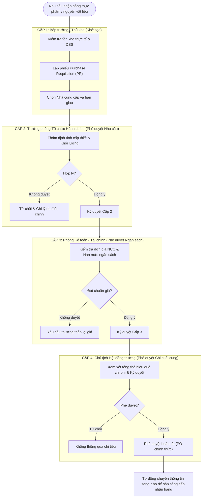

# CHƯƠNG 3 (BỔ SUNG) & 4: THIẾT KẾ CHI TIẾT QUY TRÌNH PHÊ DUYỆT 4 CẤP VÀ HỆ HỖ TRỢ RA QUYẾT ĐỊNH (DSS)

---

### 1. THIẾT KẾ CHI TIẾT QUY TRÌNH PHÊ DUYỆT MUA HÀNG 4 CẤP

Trong quản trị hệ thống thông tin nâng cao, quy trình phê duyệt nhiều cấp (Multi-level Approval Workflow) là một bài toán kinh điển nhằm kiểm soát ngân sách, ngăn chặn gian lận mua sắm và tối ưu hóa chi phí vận hành căng tin trường học.

#### 1.1. Ma trận trách nhiệm và tiêu chí phê duyệt từng cấp

#### 1.2. Máy trạng thái (State Machine) của Phiếu đề xuất mua hàng
* `DRAFT`: Phiếu đang soạn thảo bởi Bếp trưởng.
* `PENDING_TCHC`: Đã gửi, đang chờ Trưởng phòng TCHC xem xét.
* `PENDING_ACCOUNTANT`: TCHC đã duyệt, chuyển sang Kế toán thẩm định đơn giá.
* `PENDING_CHAIRMAN`: Kế toán đã duyệt, chuyển sang Chủ tịch HĐT ký chi.
* `APPROVED`: Đã được Chủ tịch HĐT phê duyệt $\rightarrow$ Tự động sinh `Purchase Order` (PO) và gửi email/thông báo cho Nhà cung cấp.
* `REJECTED`: Bị từ chối ở bất kỳ cấp nào (kèm lý do bắt buộc và trả về trạng thái điều chỉnh).
* `RECEIVED`: Hàng đã được Thủ kho nhận và nhập vào kho lưu trữ.

---

### 2. THIẾT KẾ HỆ HỖ TRỢ RA QUYẾT ĐỊNH (DSS) TRONG LẬP KẾ HOẠCH NHẬP HÀNG

#### 2.1. Đặt vấn đề và Mục tiêu DSS
* **Thực trạng:** Thực phẩm tươi sống (thịt bò, thịt heo, cá, rau củ) có thời hạn bảo quản rất ngắn (1 - 2 ngày trong kho lạnh). Nếu nhập thừa sẽ hỏng, gây lãng phí lớn; nếu nhập thiếu thì giờ trưa không đủ món phục vụ sinh viên và cán bộ, làm gián đoạn vận hành.
* **Mục tiêu DSS:** Ứng dụng mô hình toán học và dữ liệu thời gian thực để gợi ý chính xác khối lượng từng loại nguyên vật liệu cần đặt mua cho ngày hôm sau.

#### 2.2. Các biến số đầu vào của mô hình DSS
1. **$D_{ctool}$ (Nhu cầu từ CBNV Ctool):**
   Số lượng suất ăn CBNV đã đăng ký trên hệ thống Ctool cho ngày $T+1$.
   Qua định mức BOM của suất ăn CBNV, hệ thống quy đổi ra nhu cầu nguyên vật liệu $i$:
   $$M_{ctool}(i) = \sum_{j} S_j \times r_{ij}$$
   *(Trong đó $S_j$ là số suất ăn loại $j$, $r_{ij}$ là định mức nguyên liệu $i$ trên 1 suất)*.
2. **$D_{hssv}$ (Nhu cầu dự báo từ Sinh viên):**
   Dựa trên phương pháp trung bình trượt có trọng số (Weighted Moving Average) của 7 ngày cùng thứ trong quá khứ:
   $$D_{hssv}(i) = \sum_{k=1}^{n} w_k \cdot B_k(i)$$
3. **$I_{current}(i)$ (Tồn kho thực tế hiện tại):**
   Số lượng còn lại trong kho được ghi nhận tại thời điểm tính toán (15h00 hàng ngày).
4. **$SS(i)$ (Mức tồn kho an toàn - Safety Stock):**
   Được cấu hình dựa trên độ lệch chuẩn mức tiêu thụ và thời gian giao hàng (Lead time):
   $$SS(i) = Z \times \sigma_d \times \sqrt{L}$$
   *(Với $Z$ là hệ số dịch vụ 95% $\approx 1.65$, $\sigma_d$ là độ biến động tiêu thụ, $L$ là thời gian giao hàng)*.
5. **$Q_{incoming}(i)$ (Lượng hàng đang trên đường về):**
   Các đơn hàng đã duyệt nhưng nhà cung cấp chưa giao đến.

#### 2.3. Thuật toán tính toán số lượng đề xuất nhập ($Q_{recommend}$)
Hệ thống tính toán lượng đặt hàng khuyến nghị theo công thức:
$$Q_{recommend}(i) = \max\left(0, M_{ctool}(i) + D_{hssv}(i) + SS(i) - I_{current}(i) - Q_{incoming}(i)\right)$$

*Làm tròn theo quy cách đóng gói và số lượng đặt tối thiểu ($MOQ$):*
$$Q_{final}(i) = \lceil \frac{Q_{recommend}(i)}{PackSize(i)} \rceil \times PackSize(i)$$

#### 2.4. Tính năng 1-Click chuyển đổi từ DSS sang Phiếu Đề xuất (PR)
Giao diện DSS hiển thị bảng khuyến nghị trực quan:
* Cột cảnh báo màu sắc:
  - 🔴 **Khẩn cấp (Critical):** Tồn kho < 50% Safety Stock $\rightarrow$ Phải nhập ngay.
  - 🟡 **Cần nhập (Reorder):** Tồn kho $\le$ Reorder Point (ROP).
  - 🟢 **An toàn (Safe):** Tồn kho đủ cho 2-3 ngày tới.
* Bếp trưởng chỉ cần bấm **"Chuyển thành Đề xuất Mua hàng (PR)"**, toàn bộ mặt hàng có cảnh báo Đỏ và Vàng kèm số lượng $Q_{final}$ được tự động điền vào phiếu và chuyển sang quy trình phê duyệt 4 cấp.
