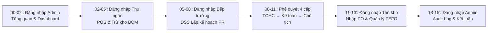

# KỊCH BẢN DEMO BÁO CÁO ĐỒ ÁN CAO HỌC MIS
## HỆ THỐNG THÔNG TIN QUẢN LÝ CĂNG TIN TRƯỜNG CAO ĐẲNG CTECH

> **Môn học:** Quản trị Hệ thống Thông tin Nâng cao  
> **Thời lượng báo cáo đề xuất:** 12 – 15 phút  
> **Kiến trúc:** Phân tách Frontend (React 18 + Vite) & Backend (Python FastAPI) + CSDL Neon Cloud PostgreSQL  
> **Mục tiêu:** Trình diễn sống động toàn bộ các quy trình nghiệp vụ cốt lõi, làm nổi bật tính liên kết dữ liệu Ctool, cơ chế trừ tồn kho định mức (BOM), quy trình phê duyệt mua hàng 4 cấp nghiêm ngặt (Strict RBAC), và hệ hỗ trợ ra quyết định (DSS).

---

## I. CÔNG TÁC CHUẨN BỊ TRƯỚC KHI THUYẾT TRÌNH

1. **Khởi chạy hệ thống:**
   * **Cách 1 (Khuyên dùng):** Nhấp đúp vào file [`start_system.bat`](file:///d:/Learning_Other/CH_TL/quan_ly_hhtt_nang_cao/CanteenManagement/start_system.bat) tại thư mục gốc dự án.  
     *(Script sẽ tự động mở 2 cửa sổ cmd cho Backend & Frontend, rồi mở trình duyệt web).*
   * **Cách 2:** Mở Terminal tại thư mục dự án và gõ lệnh:
     ```bash
     npm run dev
     ```
   * Trình duyệt web sẽ tự động mở tại: **[http://localhost:5173](http://localhost:5173)** (nhấn `F11` để phóng to toàn màn hình).
2. **Cơ sở dữ liệu:**
   * Hệ thống kết nối trực tiếp với **Neon Cloud PostgreSQL Serverless**.
   * Dữ liệu mẫu đã được nạp sẵn. Nếu cần nạp lại dữ liệu gốc, chỉ cần chạy: `npm run seed`.
3. **Quy tắc chuyển vai trò chuẩn bảo mật:**
   * Hệ thống tuân thủ mô hình **Strict RBAC** nghiêm ngặt của doanh nghiệp: Giao diện mỗi vai trò được lọc sạch sẽ, chỉ chứa đúng các chức năng được cấp phép.
   * Để đổi vai trò trong buổi demo: Bấm nút **"Đăng xuất"** ở góc trên bên phải Header $\rightarrow$ Quay về **Màn hình Đăng nhập** $\rightarrow$ Bấm trực tiếp vào thẻ vai trò tiếp theo (1-Click Quick Login) để đăng nhập tức thì mà không cần gõ mật khẩu.

---

## II. BẢNG PHÂN VAI & CÁC TÀI KHOẢN TRẢI NGHIỆM

| STT | Nhân vật đóng vai | Tài khoản | Mật khẩu | Vai trò trong hệ thống | Nhiệm vụ chính trong kịch bản |
|:---:|:---|:---|:---|:---|:---|
| 1 | **Đặng Thùy Linh** | `linh.pos` | `pos123` | Thu ngân Căn tin (`CASHIER`) | Thao tác bán hàng POS, chứng minh trừ kho tự động BOM |
| 2 | **Nguyễn Văn Đạt** | `chefnvd` | `chef123` | Bếp trưởng (`CHEF`) | Bóc tách định mức BOM, chạy DSS, lập đề xuất mua hàng (PR) |
| 3 | **Trần Thị Mai** | `mai.tchc` | `tchc123` | Trưởng phòng TCHC (`TCHC`) | Thẩm định nhu cầu & **Phê duyệt Cấp 2** |
| 4 | **Lê Hoàng Long** | `long.kt` | `kt123` | Kế toán trưởng (`ACCOUNTANT`) | Thẩm định giá NCC & **Phê duyệt Cấp 3** |
| 5 | **TS. Phạm Minh Tuấn**| `tuan.chutich`| `ct123` | Chủ tịch Hội đồng trường (`CHAIRMAN`) | Executive Dashboard & **Ký duyệt chi Cấp 4 (Ban hành PO)** |
| 6 | **Bùi Đức Thắng** | `thang.kho` | `kho123` | Thủ kho (`STOREKEEPER`) | Tiếp nhận PO đã duyệt, nhập Lô & HSD (FEFO), kiểm kê |
| 7 | **Ban Quản trị** | `admin` | `admin123` | Quản trị viên (`ADMIN`) | Giám sát toàn hệ thống, chứng minh Audit Logs bất biến |

---

## III. KỊCH BẢN CHI TIẾT TỪNG PHÚT (MINUTE-BY-MINUTE SCRIPT)



---

### PHẦN 1: MỞ ĐẦU & TỔNG QUAN HỆ THỐNG (00:00 – 02:00)

* **Thao tác đăng nhập:** Tại Màn hình Đăng nhập, bấm vào thẻ **Ban Quản trị HTTT** (`admin` / `admin123`).
* **Màn hình hiển thị:** Tab **Tổng Quan Hệ Thống (Admin Dashboard)**.

🗣️ **Lời thoại thuyết trình:**
> *"Kính thưa Thầy/Cô và Hội đồng đánh giá,*  
> *Xuất phát từ thực trạng quản lý căng tin tại Trường Cao đẳng CTECH còn nhiều bất cập: Dữ liệu suất ăn Ctool và máy chấm công vân tay không liên thông với nhà bếp; phiếu đề xuất mua hàng bằng giấy phải trình ký 4 cấp mất 1–2 ngày; thiếu công cụ dự báo dẫn đến thừa thiếu thực phẩm tươi sống; nhóm em đã xây dựng **Hệ thống Thông tin Quản lý Căng tin Trường Cao đẳng CTECH**.*  
> *Hệ thống được thiết kế theo kiến trúc 3-Tier phân tách hoàn toàn giữa Frontend (React 18 + Vite) và Backend (Python FastAPI) kết nối cơ sở dữ liệu quan hệ **Neon Cloud PostgreSQL**.*  
> *Hiện tại trên màn hình là **Dashboard Điều hành** với các chỉ số theo thời gian thực:*
> 1. *Doanh thu ca bán hôm nay từ quầy POS.*
> 2. *Tỷ lệ phục vụ suất ăn CBNV đã đồng bộ từ phần mềm Ctool và máy chấm công sáng nay.*
> 3. *Số lượng phiếu đề xuất mua hàng đang trong quy trình phê duyệt 4 cấp.*
> 4. *Cảnh báo các mặt hàng nguyên vật liệu chạm ngưỡng tồn an toàn (Safety Stock).*  
> *Sau đây em xin đăng xuất để đóng vai Thu ngân, chứng minh tính năng bán lẻ và cơ chế trừ kho tự động BOM."*

* **Thao tác kết thúc phần:** Bấm nút **"Đăng xuất"** ở góc trên bên phải.

---

### PHẦN 2: BÁN HÀNG TẠI QUẦY POS & ĐỘNG CƠ TRỪ KHO ĐỊNH MỨC BOM (02:00 – 05:00)

* **Thao tác đăng nhập:** Tại Màn hình Đăng nhập, bấm vào thẻ **Đặng Thùy Linh (Thu ngân / Bán hàng)**.
* **Màn hình hiển thị:** Tab **Quầy Bán Hàng POS**.
* **Nhấn mạnh với Hội đồng:** Menu bên trái của Thu ngân chỉ xuất hiện 2 mục: *Quầy Bán Hàng POS* và *Lịch Sử Đơn Của Ca*. Toàn bộ các chức năng duyệt giá, duyệt chi, quản lý kho đều bị ẩn sạch sẽ.

🎯 **Thao tác 1: Bán hàng cho sinh viên (Thanh toán VietQR)**
1. Chọn món: **"Cơm thịt ba chỉ kho trứng (Suất 30k)"** (1 suất) + **"Trà đào cam sả (22k)"** (1 ly).
2. Nhấn mạnh: Căn tin phục vụ đầy đủ 2 mức giá cơm HSSV **30.000 đ** và **35.000 đ** theo đúng khảo sát thực tế tại Chương 2.
3. Tại giỏ hàng bên phải, chọn loại khách hàng: **HSSV / Khách lẻ**.
4. Bấm **Thanh Toán** $\rightarrow$ Chọn phương thức **VietQR Chuyển khoản** $\rightarrow$ Hệ thống sinh mã VietQR động kèm thông tin chuyển khoản.
5. Bấm **Xác Nhận & Hoàn Tất Đơn Hàng** $\rightarrow$ Xem bản in hóa đơn bán lẻ.

🎯 **Thao tác 2: Cấp suất ăn cho Cán bộ Giảng viên (Voucher Ctool & Chống gian lận)**
1. Chọn 1 suất **"Cơm sườn nướng mật ong (35k)"**.
2. Chọn loại khách hàng: **Suất ăn CBNV Ctool**.
3. **Thao tác tìm kiếm thông minh (Debounce Search):**
   - Nhấn mạnh với Hội đồng: Hệ thống **chặn hoàn toàn việc nhập tên bừa bãi** để tránh thất thoát ngân sách phúc lợi.
   - Thu ngân gõ tìm kiếm: gõ `Hằng` hoặc mã cán bộ `0520` $\rightarrow$ Dropdown Ctool tự động xổ ra danh sách tương ứng kèm trạng thái.
   - Chọn đúng giảng viên: `ThS. Đỗ Thu Hằng (CTECH-0520 - Khoa Công nghệ thông tin)`.
   - Hệ thống tự động kiểm tra: Nếu giảng viên đã nhận suất rồi sẽ **báo đỏ hết lượt và khóa nút thanh toán**. Nếu hợp lệ sẽ tự áp dụng **Voucher trợ cấp Ctool 35.000đ**, tổng tiền khách trả về **0 đ**.
4. Bấm **Thanh Toán** $\rightarrow$ Chọn **Voucher Ctool** $\rightarrow$ Xác nhận hoàn tất đơn hàng.

🗣️ **Lời thoại thuyết trình (Điểm nhấn học thuật):**
> *"Kính thưa Thầy/Cô, ở bước này hệ thống giải quyết đồng thời 2 bài toán lớn: Thứ nhất là **chống gian lận và thất thoát chi phí phúc lợi** nhờ việc đối soát chặt chẽ với cơ sở dữ liệu CBNV Ctool theo thời gian thực (chỉ nhận đúng 1 suất/ngày). Thứ hai là cơ chế tự động hóa giữa POS và Kho thông qua bảng định mức **BOM (Bill of Materials)**. Khi em vừa thanh toán đơn hàng, động cơ BOM Engine đã tự động khấu trừ tức thì trên CSDL Neon PostgreSQL: **150g sườn heo**, **120g gạo thơm ST25** và **80g rau cải ngọt**, giúp thủ kho không còn phải cân đong thủ công cuối ngày."*

* **Thao tác kết thúc phần:** Bấm nút **"Đăng xuất"**.

---

### PHẦN 3: HỆ HỖ TRỢ RA QUYẾT ĐỊNH (DSS) TRONG LẬP KẾ HOẠCH MUA HÀNG (05:00 – 08:00)

* **Thao tác đăng nhập:** Bấm vào thẻ **Nguyễn Văn Đạt (Bếp trưởng)**.
* **Màn hình hiển thị:** Tab **Hỗ Trợ Ra Quyết Định (DSS)**.

🗣️ **Lời thoại thuyết trình:**
> *"Một trong những bài toán phức tạp nhất của căng tin trường học là thực phẩm tươi sống có hạn sử dụng rất ngắn. Nhập theo cảm tính sẽ gây hư hỏng lãng phí, hoặc thiếu món phục vụ trưa. Phân hệ **DSS** giải quyết bài toán này bằng mô hình định lượng:*  
> $$Q_{order} = \max\left(0, D_{ctool} + D_{sinh\_vien} + SS - I_{current} - Q_{incoming}\right)$$

🎯 **Thao tác trình diễn:**
1. Chỉ vào các tham số đầu vào:
   - Suất ăn CBNV từ Ctool ngày mai: `85 suất`.
   - Hệ số tồn an toàn (Safety Stock Factor): `1.0`.
   - Dự báo tỷ lệ tăng trưởng sinh viên: `1.1 (+10%)`.
2. Kéo thử thanh trượt **Dự báo sinh viên** lên `1.3 (+30%)` $\rightarrow$ Hội đồng quan sát toàn bộ bảng dự toán và số lượng gợi ý $Q_{rec}$ tự động tính toán lại tức thì!
3. Chỉ vào các dòng có nhãn màu đỏ 🔴 **Nguy cấp (CRITICAL)** (ví dụ: Thịt sườn heo, Rau cải ngọt) vì lượng tồn kho hiện tại không đủ phục vụ ngày mai sau ca bán vừa rồi.
4. Bấm nút: **"1-Click Chuyển Thành Đề Xuất Mua Hàng (PR)"**.
5. Quan sát: Hệ thống tự động gom các nguyên liệu thiếu, tính toán ngân sách dự toán và sinh ngay một phiếu đề xuất mua hàng chuẩn hóa **Biểu Mẫu BM01** ở trạng thái `PENDING_TCHC`.

* **Thao tác kết thúc phần:** Bấm nút **"Đăng xuất"**.

---

### PHẦN 4: TRỌNG TÂM: QUY TRÌNH PHÊ DUYỆT MUA HÀNG 4 CẤP (BM01) (08:00 – 11:00)

🗣️ **Lời thoại thuyết trình:**
> *"Đây là phân hệ cốt lõi thể hiện tính kỷ luật tài chính và nguyên tắc Phân tách nhiệm vụ (Separation of Duties). Toàn bộ quy trình đề xuất mua hàng được chuẩn hóa theo **Biểu Mẫu BM01** của CTECH, số hóa khép kín qua 4 cấp phân quyền nghiêm ngặt."*

🎯 **Thao tác 3 bước duyệt liên tiếp:**

* **Bước 1: Trưởng phòng TCHC thẩm định nhu cầu (Cấp 2):**
  1. Đăng nhập tài khoản **Trần Thị Mai (`mai.tchc` - Trưởng phòng TCHC)**.
  2. Vào tab **Phê Duyệt Nhu Cầu (Cấp 2)** $\rightarrow$ Chỉ rõ nhãn **[Biểu Mẫu BM01]**.
  3. Chỉ cho Hội đồng thấy: Giao diện của Trưởng phòng TCHC **CHỈ hiển thị nút "Phê duyệt Cấp 2"** và "Từ chối". Tuyệt đối không thể bấm duyệt giá hay duyệt chi ngân sách.
  4. Bấm **Phê Duyệt Cấp 2** $\rightarrow$ Hệ thống cập nhật trạng thái phiếu chuyển sang `PENDING_ACCOUNTANT`.
  5. Bấm **Đăng xuất**.

* **Bước 2: Kế toán trưởng thẩm định đơn giá & ngân sách (Cấp 3):**
  1. Đăng nhập tài khoản **Lê Hoàng Long (`long.kt` - Kế toán trưởng)**.
  2. Vào tab **Thẩm Định Giá & NS (Cấp 3)** $\rightarrow$ Chỉ rõ nhãn **[Biểu Mẫu BM01]**, kiểm tra bảng so sánh báo giá nhà cung cấp.
  3. Bấm **Phê Duyệt Cấp 3** $\rightarrow$ Trạng thái phiếu chuyển sang `PENDING_CHAIRMAN`.
  4. Bấm **Đăng xuất**.

* **Bước 3: Chủ tịch Hội đồng trường ký phê duyệt chi (Cấp 4):**
  1. Đăng nhập tài khoản **TS. Phạm Minh Tuấn (`tuan.chutich` - Chủ tịch HĐT)**.
  2. Mở tab **Dashboard Lãnh Đạo** xem dòng tiền $\rightarrow$ Chuyển sang tab **Ký Duyệt Chi (Cấp 4 - PO)** có gắn nhãn **[Biểu Mẫu BM01]**.
  3. Bấm **Ký Duyệt Chi Hoàn Tất (Cấp 4) - Ban Hành PO**.
  4. Quan sát: Phiếu chuyển thành `APPROVED`, hệ thống **tự động cấp mã Đơn đặt hàng chính thức (ví dụ: `PO-202611-xxx`)** và tự động gửi tín hiệu sang kho để chuẩn bị tiếp nhận.
  5. Bấm **Đăng xuất**.

---

### PHẦN 5: QUẢN LÝ KHO THỰC PHẨM (WMS), FEFO & KIỂM KÊ KHO (BM03) (11:00 – 13:00)

* **Thao tác đăng nhập:** Bấm vào thẻ **Bùi Đức Thắng (Thủ kho)**.
* **Màn hình hiển thị:** Tab **Tiếp Nhận PO Đã Duyệt**.

🎯 **Thao tác 1: Tiếp nhận hàng hóa theo PO đã duyệt**
1. Thấy ngay đơn PO vừa được Chủ tịch HĐT ký duyệt ở bước trước đang ở trạng thái `Chờ tiếp nhận hàng`.
2. Bấm nút **Tiếp Nhận & Nhập Kho**.
3. Modal kiểm đếm hiện ra: Thủ kho kiểm đếm thực tế, hệ thống đã sinh sẵn Mã Lô (`LOT-...`) và Ngày hết hạn (`EXP`).
4. Bấm **Xác Nhận Nhập Kho & Cập Nhật Tồn Thực Tế**.
5. Chuyển sang tab **Tồn Kho Nguyên Vật Liệu**: Chứng minh số lượng sườn heo và rau cải trong kho đã tăng ngay trên cơ sở dữ liệu.

🎯 **Thao tác 2: Kiểm soát hạn sử dụng theo nguyên tắc FEFO**
1. Chuyển sang tab **Quản Lý Lô & Hạn Dùng (FEFO)**.
2. Giải thích cơ chế:
   - Các lô hàng có hạn sử dụng dưới 3 ngày được hệ thống đánh dấu đỏ 🔴 `Cận date - Ưu tiên xuất!`.
   - Nhà bếp bắt buộc phải xuất dùng lô này trước theo nguyên tắc **First-Expired, First-Out (FEFO)** để triệt tiêu hao hụt do ôi thiu.

🎯 **Thao tác 3: Đối soát kiểm kê kho định kỳ (Biểu Mẫu BM03)**
1. Chuyển sang tab **Kiểm Kê Kho (BM03)**.
2. Chỉ cho Hội đồng thấy bảng chuẩn **Biểu Mẫu BM03**:
   - Đối soát chi tiết từng dòng: *Mã lô (L2611-01, L2611-12...), Tên nguyên liệu, ĐVT, Tồn sổ sách, Tồn thực tế, Chênh lệch, Nguyên nhân giải trình (Hao hụt cân đong tự nhiên, dập nát bảo quản)*.
   - Tính pháp lý và minh bạch nội bộ: Thể hiện đại diện chữ ký 3 bên (*Thủ kho lập biên bản - Bếp trưởng xác nhận - Kế toán trưởng thẩm định*).
   - Nút **"In Phiếu BM03"** để xuất biên bản kiểm kê in ra giấy khi có thanh tra hoặc kiểm toán trường.

* **Thao tác kết thúc phần:** Bấm nút **"Đăng xuất"**.

---

### PHẦN 6: TÍCH HỢP CTOOL (BM02), KIỂM TOÁN VÀ KẾT LUẬN (13:00 – 15:00)

* **Thao tác đăng nhập:** Đăng nhập lại **Ban Quản trị HTTT (`admin` / `admin123`)**.

🎯 **Thao tác 1: Giám sát tích hợp Ctool (Biểu Mẫu BM02)**
* Chuyển tab **Kế Hoạch Suất Ăn Ctool** có gắn nhãn **[Biểu Mẫu BM02]**:
  - Chỉ cho Hội đồng danh sách cán bộ giảng viên đăng ký ăn trưa chốt trước **21h00 hằng ngày**.
  - Hiển thị tiến độ phục vụ và đối soát ai đã nhận cơm tại quầy POS trong ngày.
  - Nút **"Chốt 21h00"** trên thanh Header để chứng minh kết nối API đồng bộ thời gian thực.

🎯 **Thao tác 2: Minh chứng tính toàn vẹn (Audit Log)**
* Chuyển tab **Nhật Ký Kiểm Toán (Audit)**:
  - Chỉ cho Hội đồng thấy chuỗi vết bất biến (Immutable Audit Trail) được lưu trong Neon PostgreSQL:
    - Thu ngân Đặng Thùy Linh bán đơn POS (ORD-...) $\rightarrow$ Trừ kho BOM.
    - Bếp trưởng Nguyễn Văn Đạt chạy DSS $\rightarrow$ Sinh phiếu PR (BM01).
    - Trưởng phòng TCHC Trần Thị Mai duyệt Cấp 2.
    - Kế toán trưởng Lê Hoàng Long duyệt Cấp 3.
    - Chủ tịch HĐT TS. Phạm Minh Tuấn ký Cấp 4 ban hành PO.
    - Thủ kho Bùi Đức Thắng nhập lô hàng LOT/EXP & lập biên bản kiểm kê BM03.
    - Trưởng phòng TCHC Trần Thị Mai duyệt Cấp 2.
    - Kế toán trưởng Lê Hoàng Long duyệt Cấp 3.
    - Chủ tịch HĐT TS. Phạm Minh Tuấn ký Cấp 4 ban hành PO.
    - Thủ kho Bùi Đức Thắng nhập lô hàng LOT/EXP.

🗣️ **Lời kết luận báo cáo:**
> *"Kính thưa Quý Thầy/Cô,*  
> *Thông qua bản demo thực nghiệm vừa rồi, Hệ thống thông tin Quản lý Căng tin CTECH đã chứng minh được tính khả thi và giải quyết trọn vẹn 3 mục tiêu lớn của môn Quản trị HTTT Nâng cao:*  
> *1. **Minh bạch tài chính & Tách biệt trách nhiệm:** Rút ngắn thời gian phê duyệt mua sắm từ 48 giờ xuống chỉ còn vài phút thông qua quy trình 4 cấp khép kín.*  
> *2. **Triệt tiêu lãng phí nguyên vật liệu:** Nhờ tích hợp Ctool và mô hình hỗ trợ ra quyết định DSS dự báo lượng đặt hàng tối ưu.*  
> *3. **Tự động hóa vận hành:** Liên thông từ POS bán lẻ đến bóc tách định mức BOM và quản lý kho theo chuẩn hạn dùng FEFO.*  
> *Em xin chân thành cảm ơn Thầy/Cô đã lắng nghe và kính mong nhận được những câu hỏi phản biện của Hội đồng!"*

---

## IV. BỘ CÂU HỎI HỘI ĐỒNG THƯỜNG HỎI & CÁCH TRẢ LỜI XUẤT SẮC

### ❓ Câu 1: Tại sao hệ thống cần quy trình phê duyệt tới 4 cấp mà không phải 2 hay 3 cấp?
* **Trả lời:**
  > *"Dạ thưa Thầy/Cô, trong cơ cấu trường cao đẳng/đại học, việc mua sắm thực phẩm liên quan trực tiếp đến 3 yếu tố: **Nhu cầu thực tế**, **Kiểm soát đơn giá/ngân sách** và **Thẩm quyền chuẩn chi tài chính**.  
  > - Bếp trưởng (Cấp 1) chỉ nắm nhu cầu chế biến.  
  > - Trưởng phòng TCHC (Cấp 2) chịu trách nhiệm quản lý chung khối dịch vụ và cơ sở vật chất, thẩm định tính cần thiết.  
  > - Kế toán trưởng (Cấp 3) kiểm soát việc đơn giá có đúng hợp đồng khung đã đấu thầu hay không và nguồn ngân sách còn hạn mức chi không.  
  > - Chủ tịch HĐT hoặc Hiệu trưởng (Cấp 4) là chủ tài khoản duy nhất có thẩm quyền chuẩn chi theo quy chế tài chính nội bộ. Mô hình 4 cấp đảm bảo tính tách biệt trách nhiệm (Separation of Duties), ngăn chặn hoàn toàn việc thông đồng mua sắm khống."*

### ❓ Câu 2: Nếu mạng bị chập chờn thì việc trừ kho BOM tại POS có bị sai lệch không?
* **Trả lời:**
  > *"Dạ thưa Thầy/Cô, trong thiết kế kỹ thuật của Backend FastAPI, giao dịch bán hàng và trừ kho nguyên liệu được gói gọn trong một Database Transaction của PostgreSQL. Nếu lưu đơn thành công nhưng trừ kho bị lỗi thì toàn bộ giao dịch sẽ rollback ngay lập tức, đảm bảo tính toàn vẹn dữ liệu (ACID). Ngoài ra, trên Frontend có cơ chế lưu vết tạm thời để tránh mất mát giao dịch khi mất kết nối."*

### ❓ Câu 3: Thuật toán DSS hoạt động như thế nào khi sinh viên nghỉ lễ hoặc có lịch thi đột xuất?
* **Trả lời:**
  > *"Dạ thưa Thầy/Cô, mô hình DSS của hệ thống có thanh trượt hệ số điều chỉnh dự báo nhu cầu ($Student\ Growth\ Factor$). Bếp trưởng có thể chủ động hạ dự báo xuống -20% hoặc -30% trong mùa thi, hoặc nâng lên +40% khi trường có hội thảo khoa học. Trong định hướng phát triển ở Chương 5 của đồ án, nhóm dự kiến tích hợp thêm Machine Learning (mô hình chuỗi thời gian SARIMA) để tự động học theo lịch đào tạo của nhà trường."*

### ❓ Câu 4: Làm thế nào để đảm bảo người dùng không thực hiện hành vi vượt quyền (Privilege Escalation)?
* **Trả lời:**
  > *"Dạ thưa Thầy/Cô, hệ thống bảo vệ 2 lớp:  
  > 1. **Lớp Giao diện (Client-side):** Sử dụng Strict RBAC Guard, các nút bấm hành động (như nút Duyệt Cấp 2, Duyệt Cấp 3, hay Duyệt Chi Cấp 4) không hề tồn tại trong cây DOM của các vai trò khác.  
  > 2. **Lớp Dịch vụ (Server-side):** Mỗi API request đều được Backend FastAPI kiểm tra Header định danh vai trò (`x-user-role`). Nếu một user gửi request trái quyền, Backend lập tức chặn đứng với mã lỗi `HTTP 403 Forbidden` và ghi vết vào `audit_logs`."*
